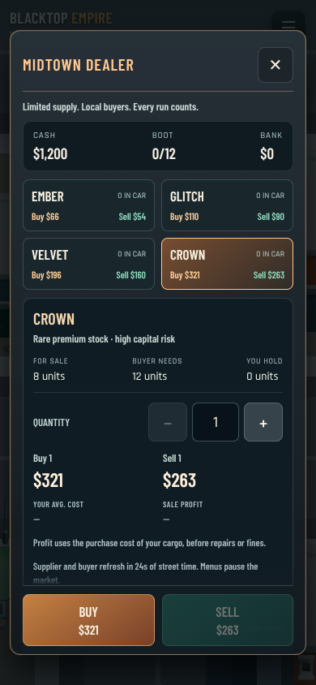
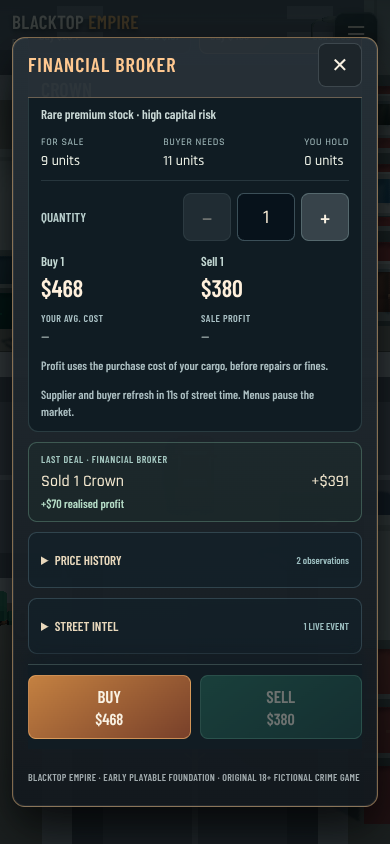

# Persistent street economy and portrait trading

13 October 2026 (Australia/Sydney). Baseline remote main: `672eff0da625ce16b6f2fe3bdeba1258a8c343c5`. This pass implements the S1 core from the final-goal roadmap. It does not implement firearms or claim the full final goal is complete.

## What changed

- Four goods and all nine existing contacts now have finite supplier stock, buyer demand, bounded replenishment, regional price profiles and a buy/sell spread. Prices respond to available stock/demand, deterministic variation and time-limited market events.
- A persistent simulation clock replaces session-only market time. Replenishment runs during active street/interior simulation, not menus/background/offline time. Port shipments temporarily lower Ember/Glitch prices; Neon Weekender demand raises Velvet/Crown prices. Event boundaries invalidate stale quotes.
- Domain transactions validate real contact position, parked speed, accessible vehicle cargo, quantity, money, capacity, supply/demand, quote revision and transaction sequence. Replayed requests cannot duplicate payment or inventory. Cash, cargo, stock, costs and receipt commit synchronously and save together; a failed primary write rolls the financial action back and visibly cancels it.
- Cargo stays in its car's stable inventory, along with weighted acquisition cost. Switching cars selects that car's inventory. Seizure clears active cargo/cost only. Safehouse stash transfers require a parked active car within 12 world units of the door; banked money and stash remain protected from cargo confiscation.
- Save payload v3 retains the existing storage key, preserving legacy cash, fleet, mods, campaign and cargo. Old cargo has unknown historic purchase cost rather than an invented profit basis. Legacy and last-known-good backups support recovery; malformed inventory quantities/costs cause recovery from valid backup rather than silently deleting goods or treating them as free.
- The portrait trade sheet shows buy/sell prices, finite limits, cargo capacity, transaction totals, average purchase cost and profit before repairs/fines. Buy/Sell stay visible through scrolling. Receipts, observed price history and actionable market intel explain the economy. Safehouse UI adds stash/load and bank/withdraw actions.
- Reload restores the day/night starting clock from elapsed simulation time. Useful existing controls, campaign, roads/assets and host/importer remain.

No new assets or dependency changes. New runtime modules: `Economy.ts` and `EconomyPanels.tsx`. Related changes: `Systems.ts`, `CrimeGame.tsx`, `World.ts`, `crime.css`. CI adds economy and rendered UI regression checks.

## Verification

**13 active crime check commands passed**, including 21 economy groups, the actual React countdown rendering check, prior physics/handling, controls, world/clock, assets, routing, street combat, daylight, skid lifetime, impacts and character disposal. Fresh TypeScript check and production Vite build passed. HTML about 9.15 MB / 2.66 MB gzip. Local runner uses Node 24 with existing installed dependencies; Node 22 frozen dependency validation belongs to GitHub CI, not this local result.

**72 browser assertions passed across three production suites:** economy 34, original controls 21, immersion 17. All run real Chromium/Three rendering with keyboard/pointer/emulated touch inputs. Software WebGL and viewport emulation do not establish physical phone FPS/audio or subjective human handling quality.

The economic playtest genuinely drove to Midtown, bought one Crown for **$321**, reloaded, drove the street into Financial Core, parked and sold it for **$391**, recording **$70 realised profit**. It confirmed supplier depletion, buyer demand, saved market time/sequence and receipts. Time-dependent quotes can differ on future runs; these are recorded results, not promised fixed prices.

Explicit fixtures isolate replay rejection, blocked storage writes, safehouse placement/cargo, remote parked-car rejection and empty dealer stock. Actual UI actions execute their transactions. These fixtures do not claim natural travel through every market or a complete arrest/campaign playthrough. Raw browser JSON contains all 34 economic assertions and their fixture notes. Controls/immersion provide their existing documented scenarios.

The initial UI regression caught offscreen BUY; sticky actions fixed it. Review found corrupted-inventory recovery and remote-car stash teleportation gaps; failing regressions were added and the fixes pass. Countdown rounding was also corrected. No outstanding review finding remains in this pass.

A 100-day deterministic market probe checked bounded prices/stocks/history/receipts: observed sale/buy range $26–$478; its sampled one-unit Port→Club Ember trades changed starting cash $100,000 to $101,861; ledger stayed at 40 entries, eight observations per observed good/contact, economic state about 17.2 KB. This is a stability/balance probe, not a complete economy balance approval.

The inherited `node scripts/test-multiplayer.mjs` suite reports **500/509 passed**, retaining the same nine established dormant-game failures:

1. out of order results clear earlier pending shots without rolling newer authority back
2. fixed district lamps stay fully lit through 60m even with a shorter building detail range
3. poster snapshot mounts once, orders overlapping images by server sequence and cancels late loads on leave
4. artwork indexed for an unloaded wall mounts when that wall becomes available
5. updated artwork cancels its stale image load and mounts the newest asset
6. timed out artwork loads release their concurrency slot and queued images continue
7. local poster renders immediately; upload completion shares only its URL and own echo does not mount twice
8. a delayed poster upload cannot publish after connection interruption, and offline placement never uploads
9. paused modal freezes held keyboard and joystick movement while gravity and third person preview continue

These are recorded, not hidden behind an “all tests pass” claim. No dormant gameplay source changed.

## Evidence and reproduction

[Raw browser report](economy-2026-10-13/economy-playtest-report.json), [active command results](economy-2026-10-13/economy-final-checks.json), [domain checks](economy-2026-10-13/economy-final-check-economy.log), [build output](economy-2026-10-13/economy-build.log), [archive suite](economy-2026-10-13/archive-tests.log.gz).

Run `node --experimental-strip-types scripts/check-economy.mjs` and `node scripts/check-economy-ui.mjs`; current CI runs the full active list. Serve the production bundle and run `scripts/playtest-economy.mjs` with the external Playwright/Chromium environment variables documented in its header and existing browser scripts. The runner starts Vite and Chromium together so their network context matches.

[Market intel](economy-2026-10-13/intel.png) · [Safehouse stash/bank](economy-2026-10-13/safehouse.png) · [360×800 layout](economy-2026-10-13/ui-360x800.png).

## Remaining work

S2's firearm encounter is next. Gang consequences, ownership, business operations, rich mission scripting and the wider final-goal content are still absent. Inventories currently support the existing one-car-per-model fleet; multiple same-model instances require a future ownership migration. Prices/events are deliberately foundational, with four fictional goods and deterministic scheduled opportunities. Dealer personalities, stronger spatial interactions and broad human balance testing remain.

Physical Android/Aippy audio, latency, thermal/performance and 30-minute stress gates remain NOT TESTED. No subscription or online service was added.
