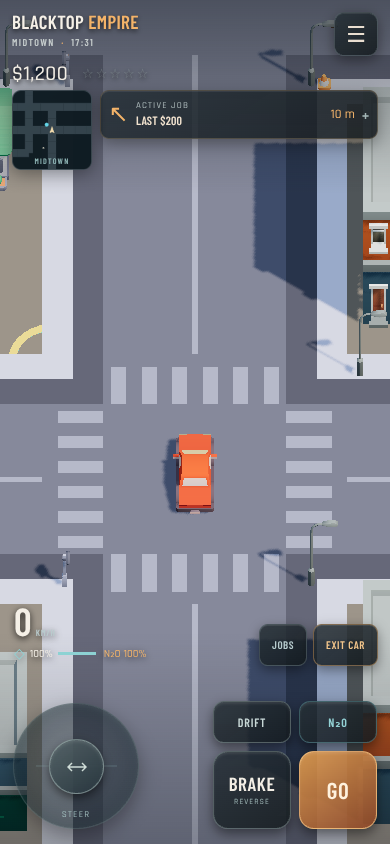
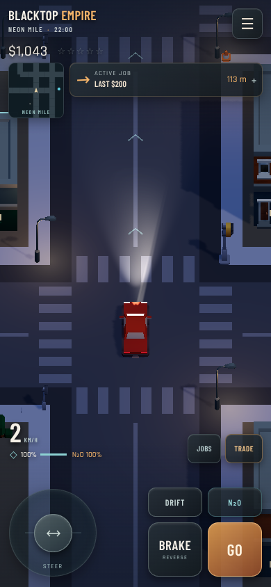
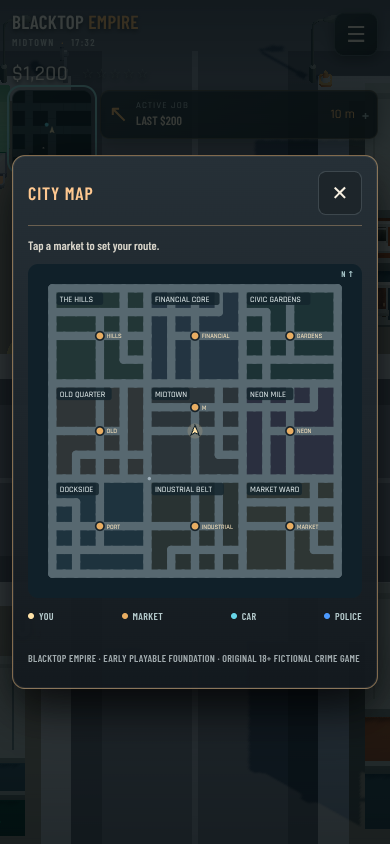

# Final-goal review: fresh browser playtest

13 October 2026 (Australia/Sydney). Scope: assess the existing game before rewriting its product goal and implementation roadmap. This pass changes documentation only.

## Build and method

Remote main inspected: `e4244aa4d92126acc7c5342bdcf21a7c28320ab2`. Runtime source commit: `7ad47a80207df8bf210f0df3996f36c8d9bfbf98`. All 77 local files under `src/crime` match the remote Git blob hashes. `src/App.tsx` selects the same crime entry; its only local difference is a trailing blank line. The local dependency environment is reconstructed, so this is not a claim of a fresh frozen-install CI reproduction.

Actual production Chromium sessions operated keyboard, pointer and emulated touch controls at 390×844, 844×390 and 1280×720. HTTPS requests were blocked to check locally available gameplay assets. Automated browser operation is real rendered gameplay, but is not a human subjective handling evaluation or physical Android testing. Explicit fixtures relocated actors/cars, selected times of day and aged skid geometry for reproducibility; they do not represent driving every route naturally.

- `playtest-immersion.mjs`: **17 assertions passed** against the existing production bundle before the rebuild.
- `playtest-districts.mjs`: **24 assertions passed**; started against that same bundle. Includes actual driving to Midtown, UI buying, reload, selling at a fixture-relocated second market, route selection, melee/flee/fight-back and a roughly 35-second autonomous traffic sample. 223 traffic observations; zero detected rotation jumps above the script threshold. This short sample cannot establish city-wide traffic reliability.
- `playtest-blacktop.mjs`: **21 assertions passed** against the freshly rebuilt production bundle. Includes emulated simultaneous steering/throttle/drift, release, reverse, safehouse walking, background return and responsive layout.
- Fresh TypeScript check: **PASS**.
- Fresh direct `node node_modules/vite/bin/vite.js build`: **PASS**, 9,127.40 kB HTML / 2,653.69 kB gzip.
- Local `pnpm build` first failed in the environment's automatic dependency-install step with `ERR_PNPM_IGNORED_BUILDS` for dependency lifecycle scripts. No approval policy was bypassed; the already-installed Vite CLI built successfully. This is not a fresh Node 22 frozen-install claim. Prior CI evidence remains historical, separate evidence.

No page runtime errors in the three browser suites; immersion additionally checked console/GPU shader errors. No new gameplay code was written and no unrelated archive tests were rerun.

Raw evidence and reproducible script names are in [goal-review-2026-10-13](goal-review-2026-10-13/). The existing scripts contain their Playwright/Chromium environment hooks and exact fixture actions.

## Findings for the new roadmap

| Status | Finding and evidence | Next action |
|---|---|---|
| PASS, scoped | Keyboard/reverse, pointer pedals, three simultaneous emulated touches and release work in the exercised scenarios. `Controls.ts`, `CrimeGame.tsx`; controls log | Physical phone feel/latency and interruption testing |
| PASS, scoped | Radar opens map, pauses simulation, selects market route; portrait/landscape render. `CityMap.tsx`; immersion log | Add ownership/contact/heat filters as those systems exist |
| PASS, scoped | Correct widened road slots, car lamps/braking/day state, fallen lamp persistence/reset, edge approach, skid expiry and physical pedestrian impulse. `World.ts`, lighting/physics modules; immersion log | More varied impacts and long-session device stress |
| PARTIAL | Trading genuinely changes money/cargo and survives reload; current price/stock model lacks economic depth. `Systems.ts::quote/trade`, `CrimeGame.tsx::deal/getPrice` | S1 persistent clock, stock, demand, spread and ledger |
| PARTIAL | Source audit: market time is session `gameTime`; saved data lacks market stock/time. Buy and sell share a quote. “Stock” rejection checks player cargo. Location is gated by UI, not `trade` | Atomic domain transaction with contact validation; reload/time/exploit regression cases |
| PARTIAL | Melee causes a target to flee or fight back; no firearm game loop in active crime implementation. `StreetCombat.ts`; district log | S2 weapon/cover/perception/control slice |
| NOT IMPLEMENTED | Persistent gang relationships, owned blocks, business operations, crew and associated UI are absent from current domain/save model | S4 integrated faction/territory slice |
| PARTIAL | Nine districts stream and routes work, but `CityLayout.ts::mergedCells` repeats the same rotated partition. Screens show wide, fairly sparse streets and repetitive surface treatment | Author distinct routes, landmarks, storefronts and density per district |
| PARTIAL | Night lamps/beam render correctly; screenshot has large plain dark surfaces and limited district-specific signs/atmosphere | Curated emissives, frontage detail, soundscape and measured lighting |
| PARTIAL | HUD controls are usable in sampled layouts; portrait image shows small low-contrast speed/condition labels on pale pavement. Job title “LAST $200” appears beside a $1,200 starting balance | Contrast/text-scale pass; narrative/economy consistency audit |
| PARTIAL / NOT TESTED | Basic five mission scripts exist; this pass did not finish campaign, race, arrest or heist end to end | Mission director and full campaign traversal/retry/save tests |
| NOT TESTED | Physical Android/Aippy FPS, thermal stability, audio quality, latency, notches and a 30-minute mixed stress run | Named-device S0/S6 release gates |

The foundation is playable. These results do not establish premium visual quality or completion of the new final goal. The highest-value next work is a persistent trade economy followed by one excellent firearm encounter, then a connected chase and faction/ownership loop.

## Fresh visual evidence

